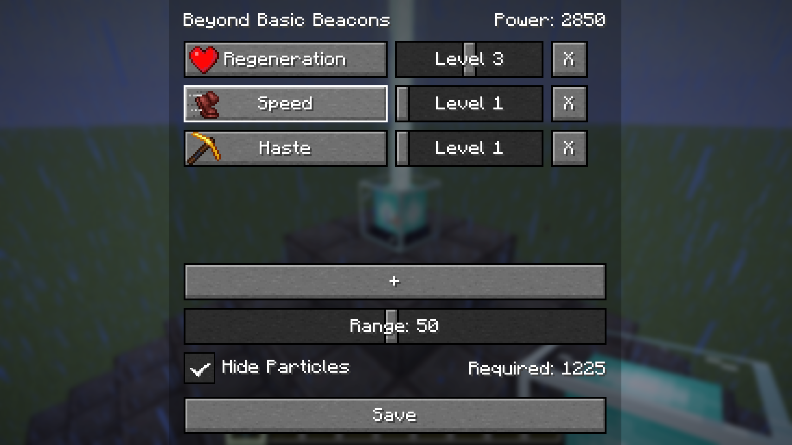
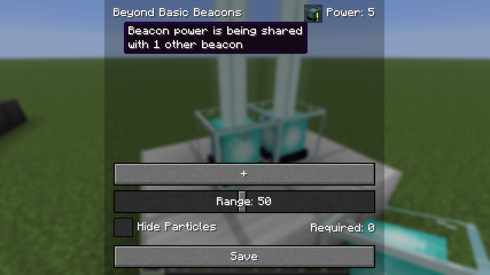

# Beyond Basic Beacons

Vanilla beacons are fairly limited. **Beyond Basic Beacons** expands the system by letting you configure multiple effects, adjust their range, and customize each beacon individually.

Built for Minecraft `1.26.2`, available for **Fabric**.

## Features

### Multiple effects

Instead of choosing a single primary effect, each beacon can support multiple effects. Each effect has its own amplifier and can be changed at any time through an icon picker.



### Beacon power system

Larger beacon bases provide more available power, allowing additional effects, stronger amplifiers, or larger ranges. The interface displays your current power usage, and highlights when you've exceeded the available budget.

### Neighboring beacons

Build beacons too close together and they'll split their available power between them instead of each getting the full amount. When that happens, a warning appears with a tooltip showing how many neighbors it's being shared with.



## Configuration

Beyond Basic Beacons utilizes configuration through datapacks.

### `beacon_settings` — Global settings

Path: `data/<namespace>/beacon_settings/*.json`

This resource contains a single settings object. If multiple datapacks provide the same file, the highest-priority datapack replaces the entire file. All fields are required.

```json
{
  "min_range": 1,
  "max_range": 100,
  "min_amplifier": 0,
  "max_amplifier": 4,
  "max_beacon_size": 10,
  "neighboring_beacon_check_range_xz": 2,
  "neighboring_beacon_check_range_y": 1,
  "max_effects_per_beacon": 10
}
```

| Field | Default | Description |
|---|--------:|---|
| `min_range` / `max_range` | 1 / 100 | Minimum and maximum beacon range. |
| `min_amplifier` / `max_amplifier` |   0 / 4 | Allowed amplifier values. |
| `max_beacon_size` |       5 | Maximum beacon pyramid size that will be checked. |
| `neighboring_beacon_check_range_xz` / `neighboring_beacon_check_range_y` |   2 / 1 | Horizontal and vertical search radius for nearby beacons. |
| `max_effects_per_beacon` |      10 | Maximum number of effects a beacon can have. |

If no datapack provides this file, the default values above are used.

### `beacon_base_block_points` — Base block values

Path: `data/<namespace>/beacon_base_block_points/*.json`

All datapacks contribute to this registry. Every `values` entry is merged together, with higher-priority datapacks overriding individual blocks when duplicates exist.

```json
{
  "values": [
    { "block": "minecraft:iron_block", "points": 1 },
    { "block": "minecraft:gold_block", "points": 2 },
    { "block": "minecraft:diamond_block", "points": 3 },
    { "block": "minecraft:emerald_block", "points": 3 },
    { "block": "minecraft:netherite_block", "points": 10 }
  ]
}
```

Blocks that are not listed contribute `0` points.

### `beacon_effect_filters` — Allowed and blocked effects

Path: `data/<namespace>/beacon_effect_filters/*.json`

Both fields are optional and default to empty lists. Lists from all datapacks are merged together.

```json
{
  "blacklist": ["minecraft:instant_damage"],
  "whitelist": []
}
```

- An empty whitelist allows every registered effect except those in the blacklist.
- A non-empty whitelist limits selectable effects to only those listed.
- If an effect appears in both lists, the blacklist takes precedence.

### `beacon_effect_costs` — Effect cost multipliers

Path: `data/<namespace>/beacon_effect_costs/*.json`

Like `beacon_base_block_points`, entries from all datapacks are merged together, with higher-priority datapacks overriding duplicate effects.

```json
{
  "values": [
    { "effect": "minecraft:strength", "multiplier": 1.5 },
    { "effect": "minecraft:regeneration", "multiplier": 2.0 }
  ]
}
```

The power cost for an effect is calculated as:

```text
(2 + amplifier)² × range × multiplier
```

Effects that are not listed use a multiplier of `1.0`.